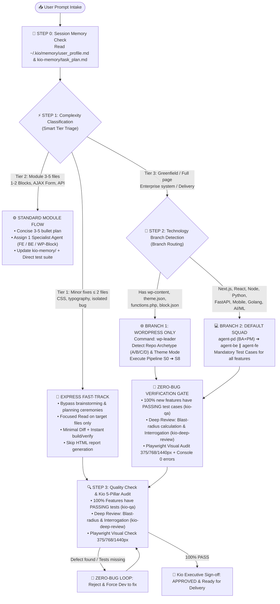

# 🧠 Master Architecture & Knowledge Base (Kio Autonomous System)

> Single Source of Truth for the Universal AI Agent System across Antigravity, Claude Code, OpenAI Codex, Cursor IDE, Windsurf, Qoder, and OpenAgents.

---

## ⚡ 1. Strategic 4-Step Intake & Execution Flow

Upon receiving any user prompt, the AI **MUST** systematically pass through the **4-Step Intake Router** before mass file reading or code generation:



---

## 🧭 2. Speed Triage Matrix (Smart Tier Routing)

| Criteria | 🚀 Tier 1: Express Fast-Track | ⚙️ Tier 2: Standard Module | 🏛️ Tier 3: Full Pipeline |
| :--- | :--- | :--- | :--- |
| **Detection** | • Minor CSS/spacing tweaks<br>• Single known bugfix<br>• Add 1 simple field<br>• Touches **≤ 2 files** (`< 50 lines`) | • Create 1–2 blocks/components<br>• 1 AJAX form / REST endpoint<br>• Single page speed optimization<br>• Touches **3–5 files** | • Greenfield project from scratch<br>• Full page from design/mockup<br>• Multi-screen feature flow<br>• Formal client delivery sign-off |
| **Context Read** | **Focused Read** on target files only. Never scan the entire repo. | Read target files + 1 sample component/helper in repo. | Read `~/.kio/memory/` and scan architecture at Step `S0`. |
| **Planning** | **BYPASS** planning ceremonies. Execute immediately. | Draft 3–5 bullet points in chat or `kio-memory/task_plan.md`. | Use `kio-brainstorming` ➔ `kio-writing-plans` (or `kio-spec-kit`) + `kio-planning-with-files`. |
| **Sub-Agents** | **NO** sub-agents. Primary agent handles directly. | Assign 1–2 specialists (`agent-fe`, `agent-be`, or `wp-block`) + `agent-qa`. | Orchestrate Full Squad (parallel dispatch via `kio-dispatching-parallel-agents`). |
| **Testing & Report** | Run build + verify target modification. Skip HTML reports. | Build + verify UI/functionality on browser + brief report. | Playwright at `1440px / 768px / 375px` + Kio 5-Pillar Audit + generate `src/report-<project>.html`. |

---

## 🔄 3. Standard Operating Procedures (SOPs)

### SOP 1: 2-Tier Memory & Continuous Self-Learning Protocol
1. **Tier 1 — Global Memory Hub (`~/.kio/memory/`)**:
   - `user_profile.md`: Ingests user coding preferences, personal rules, and style guides across all projects.
   - `global_learnings.md`: Cross-project continuous improvement log — automatically captures user feedback, root causes, and permanent preventive rules tagged with **[Project Name]**.
   - `projects_registry.md`: Machine-wide registry tracking workspace paths, active ports, and database names to prevent port/DB collisions.
   - **Continuous Self-Learning Loop**: When user provides feedback or repeats an instruction, the AI must automatically record the lesson in `global_learnings.md` and self-evolve rules to prevent future occurrences.
2. **Tier 2 — Project Memory (`<project-root>/kio-memory/`)**:
   - `task_plan.md`: Sprint checklist (`- [x]` done, `- [ ]` pending).
   - `progress.md`: Handoff memo summarizing recent work and immediate next steps.
   - `findings.md`: Project-specific ports, DB names, admin credentials, and API endpoints.

### SOP 2: Real Curated Photography vs Vector Icons
- For emotional/visual domains (Travel, Hospitality, Real Estate, Food & Beverage, Fashion, Architecture), **ALWAYS use high-resolution real photography** (Unsplash, Pexels, or production assets).
- Abstract flat SVG polygons and grey placeholders are **STRICTLY PROHIBITED** for landscape and product imagery.
- Pair images with high-contrast gradient overlays for text legibility (WCAG AAA ≥ 7:1) and enforce explicit dimensions (`CLS = 0.00`).
- **Automated Before/After Evidence**: Automatically capture browser screenshots before and after every UI/UX modification for side-by-side evidence reports.

---

## 🛡️ 4. Kio 5-Pillar Executive Audit Sign-off

```markdown
[👑 Kio Agent - Master Executive Review & Final Approval]

- Audit Status: [APPROVED 100% / REJECTED - NEEDS FIX]
- 5-Pillar Executive Audit:
  1. 🛡️ Security & Zero-Trust: [PASS - 0 exposed secrets, 100% sanitized/escaped, Multi-layer anti-bot]
  2. 🪢 Code Quality & Lean: [PASS - 0% TODO, every file < 700 lines, strictly conforms to Repo Archetype]
  3. 🎨 UI/UX Taste & Anti-Slop: [PASS - Anti-Slop, Real Curated Photography, zero horizontal bleed 360px–1440px]
  4. ⚡ Architecture & Mandatory Tests: [PASS - 100% features have passing test cases, LCP eager, CLS 0.00]
  5. 🎯 Business Alignment & QA: [PASS - 100% tests pass green, browser verified with side-by-side evidence]

- Executive Sign-off: SYSTEM MEETS THE HIGHEST INDUSTRY STANDARDS & IS APPROVED FOR PRODUCTION DELIVERY!
```
