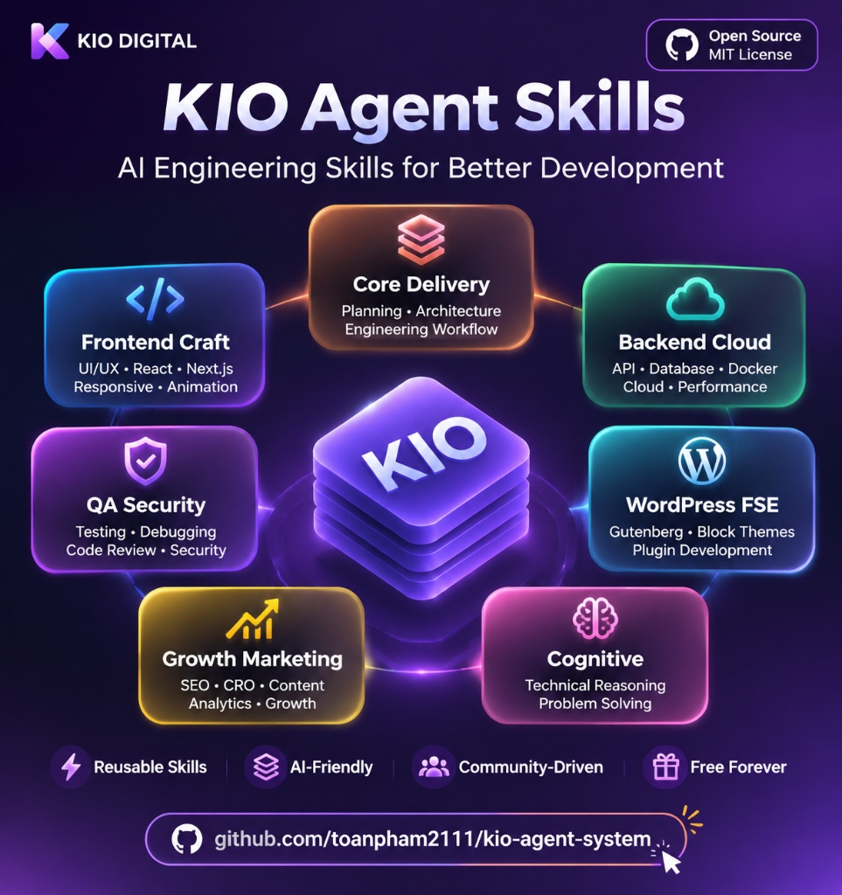

# 🧰 Kio — Open Source AI Skills Collection for Modern Software Engineering

<div align="center">

[](https://opensource.org/licenses/MIT)
[](https://github.com/toanpham2111/kio-agent-system/releases)
[](https://github.com/toanpham2111/kio-agent-system)
[](skills/)
[](skills/)
[](evaluations/SKILL_EVALUATION_FRAMEWORK.md)
[](LICENSE)

**A modular, open-source collection of engineering skills designed for AI coding tools.**  
*Plug-and-play skills for Frontend UI/UX, Backend APIs, Automated QA Testing, Marketing CRO, and WordPress FSE.*

[🚀 Installation Guide](#-installation-guide) • [⚡ 2-Minute Quickstart](#-2-minute-quickstart) • [🧰 The 7 Core Skills](#-the-7-core-engineering-skills) • [📖 Per-Skill Usage Guide](#-per-skill-usage-guide-prompts--expected-outputs) • [🧪 Skill Evaluation Framework](#-skill-evaluation-framework) • [🧩 Compatibility Matrix](#-compatibility-matrix) • [❓ Troubleshooting & FAQ](#-troubleshooting--faq)

</div>

<p align="center">
  
</p>

---

## 💡 What is Kio?

**Kio is an open-source collection of specialized AI coding skills.** It is not a heavy framework that requires deploying servers, running background daemons, or setting up complex infrastructure.

Instead, Kio provides ready-to-use skill packages following the standard `SKILL.md` format. When you link or copy these skills into your preferred AI coding tool (**Claude Code**, **Cursor**, **Codex**, or **Google Antigravity**), your AI assistant instantly gains focused domain knowledge, structured engineering workflows, and concrete checklists:

- **Frontend Craft**: 79 design styles, 192 contrast-tested color palettes, 60fps Lenis smooth scroll conventions, defensive spacing, and rules to eliminate generic AI layouts.
- **Backend & Cloud**: Practical REST/GraphQL patterns, PostgreSQL indexing strategies, Supabase Row-Level Security (RLS), idempotent webhook processing, and Docker multi-stage builds.
- **QA & Testing**: Automated 4-quadrant test case matrices, multi-language unit test boilerplates (Vitest, Pytest, Go), and headless browser visual checks via Playwright.
- **Structured Delivery**: Atomic task planning (2-5 minute steps) and specification-driven development (SDD) before writing code.
- **Growth & Marketing**: 53 conversion rate optimization (CRO) frameworks and technical SEO/GEO guidelines optimized for modern AI search engines.
- **WordPress FSE**: Full Site Editing workflows for clean, 100% native Gutenberg block theme creation without third-party page builder bloat.

---

## 🧪 Real-World Test: Without Skill vs With Kio

Same request *"a fresh-seafood shop website in Da Nang with proper SEO"*, same model **Claude Sonnet 5.5**, one run without a skill and one with `kio-frontend-craft` (2026-11-22, Kio v1.3.0).

| Desktop 1440 px | Mobile 375 px |
|:---:|:---:|
|  |  |

| | Without skill | With Kio |
|---|:---:|:---:|
| **Blind judge score** (Opus 5.5, out of 100) | 75 | **86** |
| Lighthouse mobile — Perf / A11y / Best Practices / SEO | 100 / 96 / 100 / 100 | 98 / **100** / 96 / 100 → **100 / 100 / 100 / 100** after the skill fix ¹ |
| Contrast failures | main order button 2.8:1 | **0** |
| Order form | shows success but sends nothing | validates and sends the order |
| Mobile edge overflow / `&amp;` entities | 1 / 1 | **0 / 0** |
| Time | **1 min 55 s** | 8 min 2 s |
| Output / input tokens | **20,387 / 97,344** | 42,951 / 1,663,477 (96% cache reads) |
| Cost | **US$0.33** | US$0.86 |

¹ The Kio page scored slightly lower because of a real hero photo, a render-blocking Google Fonts stylesheet and a missing favicon (the baseline was HTML + CSS with emoji only). Non-blocking fonts plus a favicon give 100/100/100/100; both are now mandatory skill rules.

Kio produced a clearly better page on design, accessibility and form reliability, at roughly 2.6–4× the time and tokens. One run per condition. Details, full-page screenshots, source code and data: [`evaluations/showcase/seafood-v1.3`](evaluations/showcase/seafood-v1.3/README.md).

---

## ⚡ 2-Minute Quickstart

You do not need to read through thousands of documentation files to start using Kio. Get up and running in 3 simple steps:

### Step 1: Install Kio on your machine (takes under 10 seconds)
Open your terminal and run the one-line command:
```bash
# Linux / macOS / WSL:
curl -fsSL https://raw.githubusercontent.com/toanpham2111/kio-agent-system/main/setup.sh | bash

# Windows PowerShell:
irm https://raw.githubusercontent.com/toanpham2111/kio-agent-system/main/setup.ps1 | iex
```

### Step 2: Open your AI coding assistant
Launch your favorite AI tool: `claude`, `cursor`, `codex`, or `agy`. The tool will automatically detect the linked `SKILL.md` files in its configuration directory.

### Step 3: Copy and test an immediate prompt

Try pasting one of these tested prompts into your AI:

> **Frontend Test Prompt**:  
> *"Design a 3-tier SaaS pricing table in React with Tailwind CSS. Apply a tech-focused color palette with high contrast meeting WCAG AA standards, add micro-interactions on hover, and ensure defensive spacing that never bleeds on mobile."*

> **QA & Testing Test Prompt**:  
> *"Generate a 4-quadrant test case matrix (Happy Path, Boundary, Edge Case, Failure Mode) and write complete Vitest unit tests for a shopping cart checkout function with coupon discounts and tax calculations."*

**Immediate Result**: Your AI tool automatically detects and activates the matching Kio skill, producing clean, production-grade output without messy templates or generic AI styling.

---

## 🚀 Installation Guide

Kio installs as a set of safe, non-destructive symbolic links directly into your local AI tool configuration directories (`~/.claude/skills`, `~/.cursor/skills`, `~/.gemini/config/skills`).

> **🛡️ 5 Safety & Clean Design Guarantees**:
> - **⬇️ Install Skills**: Install all 7 skills or choose specific individual skills.
> - **✅ Preserve Existing Skills**: Never deletes, renames, or overwrites any of your personal skills (folders or custom symlinks).
> - **🔍 Realpath Target Inspection**: Verifies symlink destinations, updating only symlinks that point to the Kio repository.
> - **📋 Ownership Manifest**: Centrally tracks Kio-managed symlinks in `~/.kio/manifest.json`.
> - **🗑️ Clean Uninstall**: Safely removes only Kio-installed symlinks, leaving all other user skills untouched.

### Method 1: One-Line Installer (Recommended)

#### Linux / macOS / WSL:
```bash
curl -fsSL https://raw.githubusercontent.com/toanpham2111/kio-agent-system/main/setup.sh | bash
```

#### Windows (PowerShell):
```powershell
irm https://raw.githubusercontent.com/toanpham2111/kio-agent-system/main/setup.ps1 | iex
```

> **Which version gets installed:** the one-line installer installs the **latest release** (newest `v*` tag), never unreleased work on `main`. Re-run it to update. To choose another version: `curl -fsSL .../setup.sh | KIO_REF=v1.1.0 bash` (or `KIO_REF=main`); on Windows: `$env:KIO_REF="v1.1.0"; irm .../setup.ps1 | iex`. If an update fails, the installer prints the error and exits with code `2`; your skills keep using the copy already on disk.

---

### Method 2: Granular Installation & CLI Options

You can install single skills, inspect available packages, or safely uninstall at any time:

```bash
# List all 7 skills and their command shortcuts
./setup.sh --list

# Install all 7 skills (default)
./setup.sh

# Install specific skill(s) only (e.g. Frontend & QA)
./setup.sh --skill frontend,qa

# Safely uninstall Kio skills (preserves all your personal skills)
./setup.sh --uninstall
```

*(On Windows PowerShell, use `.\setup.ps1 -Skill frontend,qa` and `.\setup.ps1 -Uninstall`)*

---

### Method 3: Copy Single Skills to Your Project
If you prefer not to create global symlinks, simply clone the repository and copy any skill folder into your project's `.claude/skills/` or `.cursor/skills/` directory:
```bash
git clone https://github.com/toanpham2111/kio-agent-system.git
cp -r kio-agent-system/skills/kio-frontend-craft path/to/your-project/.claude/skills/
```

---

## 🧰 The 7 Core Engineering Skills

All capabilities are organized into 7 self-contained master skills located in the `skills/` directory:

| Skill Directory | Focus Area | What It Gives Your AI Assistant |
| :--- | :--- | :--- |
| **[`skills/kio-frontend-craft`](skills/kio-frontend-craft)** | **Frontend UI/UX & Motion** | 79 searchable styles, 192 contrast-checked palettes, 74 font pairings and 22 framework rule sets (search CLI), 64 React/Next.js performance rules, Core Web Vitals (PageSpeed 95–100) audits, the 9-pass /unslop redesign SOP, Lenis smooth scroll, PDF → responsive HTML, React Native / Expo / SwiftUI guides, **free stock photos with credits** (Unsplash, Pexels, Openverse) and a **layout check** (`layout-check.js`: no edge spill, aligned rows, no wrapped buttons, no HTML entities like `&amp;`). |
| **[`skills/kio-backend-cloud`](skills/kio-backend-cloud)** | **Backend, DB & Cloud** | REST/GraphQL API and auth (anti-IDOR) design, payments with idempotent webhooks (Stripe, PayPal, VNPay, MoMo, PayOS, SePay — tested reference code), PostgreSQL / Supabase RLS, EXPLAIN-driven indexing, zero-downtime migrations, Docker, GitHub Actions, Terraform, RAG with pgvector, QLoRA fine-tuning, and MCP servers in Python or TypeScript. |
| **[`skills/kio-qa-security`](skills/kio-qa-security)** | **Automated QA & Security** | 4-quadrant test matrices and unit-test templates (Vitest, Pytest, Go), TDD and systematic debugging (root-cause tracing, flaky-test and test-pollution tools), deep review of risky diffs (blast radius, interrogation, arena), security review with Semgrep and CodeQL SAST (scripts + tests), and Playwright E2E visual QA at 375/768/1440 px. |
| **[`skills/kio-core-delivery`](skills/kio-core-delivery)** | **Planning & Delivery** | Decomposes vague prompts into 2-5 minute atomic tasks, creates technical specifications (Specification-Driven Development), and manages multi-engine task routing. |
| **[`skills/kio-growth-marketing`](skills/kio-growth-marketing)** | **Growth, CRO & SEO** | One router over 79 sub-skills: 53 growth modules (CRO, copywriting, pricing, email, ads, launches, analytics, RevOps…) and 26 SEO Engine sub-skills (technical SEO, schema, AI search / GEO, local SEO) with 19 agents and 60+ Python checks. |
| **[`skills/kio-wordpress-fse`](skills/kio-wordpress-fse)** | **WordPress FSE** | Step-by-step S0-S8 industrial pipeline for turning designs or HTML mockups into clean, 100% native Gutenberg block themes without plugin bloat. |
| **[`skills/kio-cognitive`](skills/kio-cognitive)** | **Deep Thinking & Rationale** | First-principles analysis methods, architectural decision walkthroughs ("Why & How"), and post-mortem failure analysis for continuous learning. |

---

## 📖 Per-Skill Usage Guide (Prompts & Expected Outputs)

Each skill is designed to activate on demand when given a relevant prompt. Use the real-world prompt examples below:

### 1. `kio-frontend-craft`
- **When to Use**: Building web interfaces, mobile layouts, fixing alignment bugs, removing generic AI styling, or auditing color contrast.
- **Stock photos**: when you have no real photos, the skill fetches free stock images with credits. Set `UNSPLASH_ACCESS_KEY` (unsplash.com/developers) or `PEXELS_API_KEY` (pexels.com/api) for the best results; without a key it uses Openverse (openly licensed, smaller images).
- **Prompt Example**:
  ```text
  "Build a responsive SaaS analytics dashboard in React + Tailwind CSS with MRR metric cards, a recent transactions table, dark mode support, and an empty state."
  ```
- **Expected Output**:
  - Asymmetric Bento Grid layout with defensive padding that never clips screen borders at `375px` or `1440px`.
  - Palette selected from curated system with 80/15/5 distribution (80% neutral background, 15% structure, 5% accent).
  - Clean interactive buttons with defined hover, focus-visible, and active states. No cliche purple gradients.

### 2. `kio-backend-cloud`
- **When to Use**: Designing REST or GraphQL endpoints, drafting database migrations, securing PostgreSQL tables with RLS, and writing Dockerfiles.
- **Prompt Example**:
  ```text
  "Create a PostgreSQL schema for a multi-tenant project management app in Supabase with strict Row-Level Security policies."
  ```
- **Expected Output**:
  - Production-ready SQL with explicit `ENABLE ROW LEVEL SECURITY;`.
  - Distinct policies for `SELECT`, `INSERT`, `UPDATE`, and `DELETE` scoped to `auth.uid()` and `tenant_id`.
  - B-Tree indexes on foreign keys to prevent sequential table scans.

### 3. `kio-qa-security`
- **When to Use**: Designing test plans, generating test case matrices, writing unit tests (Vitest/Pytest), and setting up Playwright visual tests.
- **Prompt Example**:
  ```text
  "Create a 4-quadrant test case matrix and write comprehensive Vitest unit tests for user authentication (JWT login) including brute-force rate limit edge cases."
  ```
- **Expected Output**:
  - Structured matrix covering Happy Path, Boundary, Edge Case, and Failure Mode.
  - Complete Vitest test suite with safe external mocks, clear assertions, and >90% branch coverage.

### 4. `kio-core-delivery`
- **When to Use**: Breaking down large epics into small steps, writing technical specification documents, or coordinating multi-engine task delivery.
- **Prompt Example**:
  ```text
  "I want to build an automated PDF invoice export service. Create an SDD specification document and break it down into 2-5 minute atomic tasks."
  ```
- **Expected Output**:
  - Structured spec defining Inputs, Outputs, Failure Cases, and Dependencies.
  - Ordered checklist of atomic tasks (e.g., Task 1: HTML template, Task 2: PDF renderer, Task 3: API route, Task 4: Unit tests).

### 5. `kio-growth-marketing`
- **When to Use**: Landing page conversion optimization, pricing psychology, technical SEO audits, and Schema.org structured data.
- **Prompt Example**:
  ```text
  "Restructure this coding bootcamp landing page to maximize signups, and generate valid Schema.org Course JSON-LD markup."
  ```
- **Expected Output**:
  - High-converting 6-tier page hierarchy (Hero $\rightarrow$ Social Proof $\rightarrow$ Core Benefits $\rightarrow$ Curriculum $\rightarrow$ Pricing $\rightarrow$ FAQ).
  - Syntactically valid JSON-LD `@type: "Course"` snippet ready for Google Rich Snippets.

### 6. `kio-wordpress-fse`
- **When to Use**: Converting HTML/Figma mockups into Gutenberg Full Site Editing (FSE) block patterns, themes, or templates.
- **Prompt Example**:
  ```text
  "Convert this Hero section design into a native WordPress Gutenberg Block Pattern for Full Site Editing."
  ```
- **Expected Output**:
  - Clean pattern file placed in `patterns/` using native comments (`<!-- wp:group -->`, `<!-- wp:heading -->`, `<!-- wp:buttons -->`).
  - Seamless styling connected with `theme.json` without hardcoded CSS overrides.

### 7. `kio-cognitive`
- **When to Use**: Architecture trade-off evaluations, first-principles reasoning, and post-mortem root cause analysis.
- **Prompt Example**:
  ```text
  "Evaluate the trade-offs between storing file uploads directly as database BLOBs versus S3 Object Storage Presigned URLs from first principles."
  ```
- **Expected Output**:
  - Multi-dimensional breakdown: database I/O overhead, network latency, backup complexity, server bandwidth, and operational cost.
  - Concrete technical recommendation mapped to specific throughput thresholds.

---

## 🧪 Skill Evaluation Framework

Kio validates capability through transparent, reproducible benchmarks and live execution evidence. All **7 Master Skills** are defined and benchmarked against the **[Kio Skill Evaluation Framework](evaluations/SKILL_EVALUATION_FRAMEWORK.md)** across 21 test scenarios:

| Skill Group | Scenarios | Evaluation Focus | Benchmark Status | Raw Evidence Logs |
| :--- | :---: | :--- | :---: | :--- |
| **`kio-frontend-craft`** | 5 | Bento Grid, Mobile 375px, 9-Pass /unslop, Negative Tests (No forced Lenis, WCAG audit) | 🟢 5/5 Scenarios Defined | [`results/frontend/`](evaluations/results/frontend/) |
| **`kio-backend-cloud`** | 4 | Supabase RLS, Docker multi-stage, SQL injection prevention, Webhook idempotency | 🟢 4/4 Scenarios Defined | [`results/backend/`](evaluations/results/backend/) |
| **`kio-qa-security`** | 4 | 4-quadrant test matrices, Vitest unit tests, Reject mock-only solutions | 🟢 4/4 Scenarios Defined | [`results/qa/`](evaluations/results/qa/) |
| **`kio-core-delivery`** | 2 | 2-5 minute atomic task breakdowns, Elimination of ambiguous steps | 🟢 2/2 Scenarios Defined | [`results/core/`](evaluations/results/core/) |
| **`kio-growth-marketing`** | 2 | CRO funnel hierarchy, Valid Schema.org JSON-LD | 🟢 2/2 Scenarios Defined | [`results/marketing/`](evaluations/results/marketing/) |
| **`kio-wordpress-fse`** | 2 | Native Gutenberg block patterns, Zero external builder dependency | 🟢 2/2 Scenarios Defined | [`results/wordpress/`](evaluations/results/wordpress/) |
| **`kio-cognitive`** | 2 | First-principles trade-off analysis, Root cause post-mortems | 🟢 2/2 Scenarios Defined | [`results/cognitive/`](evaluations/results/cognitive/) |

> **Latest A/B re-run (v1.2.0, Claude Code, blind judge, n = 1):** average 7.61 → 8.01 (+0.40) across 10 scenarios; largest gain FE-01 (+3.8), 4 scenarios scored lower. Details and caveats in [`benchmark-summary.md`](evaluations/benchmark-summary.md); per-scenario evidence in [`results-v1.2.0/`](evaluations/results-v1.2.0/).

📖 **Review full evaluation framework and live logs**:  
👉 **[Read the Skill Evaluation Framework (SKILL_EVALUATION_FRAMEWORK.md)](evaluations/SKILL_EVALUATION_FRAMEWORK.md)**  
👉 **[Read Live Benchmark Summary & Evidence Logs (benchmark-summary.md)](evaluations/benchmark-summary.md)**

---

## 🧩 Compatibility Matrix

Kio adopts the standard `SKILL.md` format. Verification statuses across major AI coding assistants and operating systems are categorized into four transparent tiers:

| AI Coding Tool | Auto-Discovery Path | Linux | macOS | Windows / WSL | Compatibility & Verification Tier |
| :--- | :--- | :---: | :---: | :---: | :--- |
| **Claude Code** | `~/.claude/skills/` or `<project>/.claude/skills/` | ✅ | ✅ | 🟡 | 🟢 **Tested & Verified** (Full test evidence available) |
| **Google Antigravity** | `~/.gemini/config/skills/` | ✅ | ✅ | 🟡 | 🟢 **Tested & Verified** (Full test evidence available) |
| **Cursor IDE** | `~/.cursor/skills/` or `<project>/.cursor/skills/` | ✅ | ✅ | 🟡 | 🟡 **Tested** (Installation and basic discovery verified) |
| **Codex CLI** | `~/.codex/skills/` or `<project>/.codex/skills/` | ✅ | ✅ | 🟡 | 🟡 **Tested** (Installation and basic discovery verified) |
| **Windsurf / Cascade** | `<project>/.windsurf/skills/` | 🔄 | 🔄 | 🔄 | 🔵 **Supported** (Requires manual copy into project directory) |

> **Windows note:** 🟡 until `setup.ps1` (changed in v1.1.0 and v1.2.0) has been run on a real Windows machine again. `setup.sh` was re-tested on Linux for v1.2.0.

> **Verification Tier Definitions**:
> - 🟢 **Tested & Verified**: Fully tested in production environments with benchmark logs available in `evaluations/results/`.
> - 🟡 **Tested**: Verified to install cleanly and parse `SKILL.md` specifications.
> - 🔵 **Supported (Manual)**: Specification-compatible; requires manual folder copy into the local workspace.

---

## ❓ Troubleshooting & FAQ

### Troubleshooting Common Issues

#### 1. Symbolic link privilege errors on Windows:
- **Symptom**: PowerShell outputs `New-Item: A required privilege is not held by the client` or fails to link skills.
- **Resolution**: Enable **Developer Mode** in Windows Settings (`Settings > Update & Security > For developers > Developer Mode: ON`), or run PowerShell with **Run as Administrator**.

#### 2. AI tool does not recognize skills after running the installer:
- **Symptom**: Launching `claude` or Cursor shows no change in assistant behavior.
- **Resolution**: Restart the AI CLI session (exit and restart `claude`) or reload the Cursor window to refresh the tool skill cache.

#### 3. Legacy skill name conflicts:
- **Symptom**: Existing symlinks or older versions cause the installer to skip updates.
- **Resolution**: Run `./setup.sh --uninstall` to cleanly remove previous Kio links, then rerun `./setup.sh` to recreate clean symlinks.

---

### Frequently Asked Questions (FAQ)

> **Q1: Does Kio slow down AI response times or consume excessive tokens?**  
> **No.** Kio operates on **Lazy Context Loading**. Your AI assistant only reads the title and brief description from the YAML frontmatter. Detailed skill instructions are only pulled into the active context when your prompt specifically demands them.

> **Q2: Do I need to buy additional API keys or pay extra fees?**  
> **No.** Kio consists of open-source Markdown skill files (`SKILL.md`). It runs directly inside your existing AI tool subscription without requiring any external Kio API key.

> **Q3: Can I install only the Frontend skill without installing the others?**  
> Yes. Simply run `./setup.sh --skill frontend` (or `.\setup.ps1 -Skill frontend` on Windows). The installer will link only `kio-frontend-craft`.

> **Q4: Does Kio run background daemons or consume system RAM?**  
> **No background processes are created.** Kio consists strictly of static markdown files and symbolic links. When your AI tool is closed, Kio consumes zero CPU cycles and zero RAM.

---

## 📂 Repository Structure

The repository maintains a clean, transparent layout centered on the `skills/` directory:

```
kio-agent-system/
├── skills/                           # Core: 7 Self-contained engineering skills
│   ├── kio-frontend-craft/           # UI/UX, styles, palettes, Lenis smooth scroll
│   ├── kio-backend-cloud/            # API design, database RLS, Docker, cloud setups
│   ├── kio-qa-security/              # Test case matrix, unit tests, Playwright checks
│   ├── kio-core-delivery/            # Atomic task planning, spec-kit templates
│   ├── kio-growth-marketing/         # Conversion frameworks, technical SEO modules
│   ├── kio-wordpress-fse/            # WordPress block theme creation pipeline
│   └── kio-cognitive/                # Architecture rationale walkthroughs
├── evaluations/                      # Skill Evaluation Framework & Live Benchmarks
│   ├── SKILL_EVALUATION_FRAMEWORK.md # 21 verified test scenarios
│   ├── benchmark-summary.md          # Live benchmark summary report
│   └── results/                      # Raw evidence logs per scenario (FE, BE, QA...)
├── agents/                           # Optional: 6 Role-specialized agent personas
│   ├── kio.md                        # Coordinator persona for task triage & review
│   ├── agent-pd.md                   # Product & specification planner persona
│   ├── agent-fe.md                   # Frontend engineering specialist persona
│   ├── agent-be.md                   # Backend & database specialist persona
│   ├── agent-qa.md                   # QA & test verification specialist persona
│   └── wp-leader.md                  # WordPress FSE technical lead persona
├── memory/                           # Optional: Cross-session notes & project registry
│   ├── global_learnings.md           # Tracked lessons learned across projects
│   ├── user_profile.md               # User preferences & tech stack notes
│   └── projects_registry.md          # Active local dev ports registry
├── docs/                             # Engineering guides & operational SOPs
│   ├── releases/                     # Release notes per version
│   └── RELEASE_WORKFLOW.md           # Dual-repository release & synchronization SOP
├── rules/                            # Optional: Global coding guidelines
│   ├── GLOBAL_RULE.md                # General code quality & safety rules
│   └── wp-build-pipeline.md          # WordPress FSE technical checklist
├── scripts/                          # Utility & synchronization scripts
├── setup.sh                          # Safe 1-command installer for Linux/macOS/WSL
├── setup.ps1                         # Safe 1-command installer for Windows
├── CONTRIBUTING.md                   # Contribution guidelines
├── CHANGELOG.md                      # Release changelog (Semantic Versioning)
├── SECURITY.md                       # Security policy and disclosure
├── CODE_OF_CONDUCT.md                # Contributor Covenant Code of Conduct
├── README.md                         # Primary documentation
└── LICENSE                           # MIT License
```

---

## 🛠️ How Skills Work in Your IDE

When an AI coding assistant (like Claude Code, Cursor, or Antigravity) reads a skill:

1. **Context-Triggered Loading**: The assistant inspects the `name` and `description` frontmatter inside each `SKILL.md`.
2. **On-Demand Activation**: When your prompt involves frontend styling, database design, or unit testing, the tool loads only the matching skill into memory—keeping token usage low.
3. **Actionable Instructions**: Rather than hallucinating rules, the AI follows the verified code snippets, directory conventions, and checklists documented in the skill.

---

## 🤖 Optional: Multi-Agent Workflows & Orchestration

For developers who want an orchestrated team experience beyond standalone skills, Kio includes optional multi-agent assets:

### 1. The 6 Sub-Agent Personas (`agents/`)
If your environment supports custom agents or sub-agent delegation, you can invoke specialized roles:
- **`kio`**: Coordinates high-level planning and reviews final diffs.
- **`agent-pd`**: Gathers requirements and writes task specs before coding begins.
- **`agent-fe`**: Implements client-side views and animations.
- **`agent-be`**: Handles database models, server endpoints, and cloud infra.
- **`agent-qa`**: Writes unit tests, checks for regressions, and runs Playwright.
- **`wp-leader`**: Orchestrates WordPress theme development.

### 2. Multi-Engine Task Routing (`kio_router.py`)
Located in `skills/kio-core-delivery/scripts/kio_router.py`, this optional utility helps recommend which CLI tool fits a specific subtask best:
- **Claude Code (`claude -p`)**: Recommended for frontend craft, CSS micro-interactions, and nuanced copywriting.
- **OpenAI Codex (`codex exec`)**: Recommended for heavy algorithm tasks, complex SQL queries, and unit test generation.
- **Google Antigravity (`agy -p`)**: Recommended for large monorepo context scanning (1M-2M tokens) and document extraction.

### 3. Persistent Memory Notes (`memory/`)
A simple file-based memory system allowing your local tools to remember:
- Recurring bugs and lessons learned (`memory/global_learnings.md`)
- Preferred tech stacks (`memory/user_profile.md`)
- Local development ports to avoid port collisions (`memory/projects_registry.md`)

---

## 📄 License, Credits & Contributing

Kio is open source and licensed under the **[MIT License](LICENSE)**.

### 🙏 Credits & Third-Party Open Source Acknowledgments

Kio unifies, adapts, and extends open-source agent skill specifications, datasets, and tooling under the MIT License. We gratefully acknowledge the original authors and contributors of the following upstream open-source projects (full copyright notices are preserved in **[THIRD_PARTY_NOTICES.md](THIRD_PARTY_NOTICES.md)**):
- **Marketing & CRO Frameworks**: Adapted and modularized from `marketingskills` by Corey Haines (`coreyhaines31/marketingskills`, MIT License).
- **Technical SEO & GEO Sub-skills**: Adapted and integrated from `claude-seo` & `claude-ads` by Daniel Agrici (`AgriciDaniel/claude-seo`, MIT License), Ivan Kuznetsov (`ivankuznetsov/claude-seo`, MIT License), and `flow` framework prompts (CC BY 4.0).
- **Frontend UI/UX Datasets**: Style, typography, and palette datasets in `skills/kio-frontend-craft/data/` adapted from `ui-ux-pro-max-skill` (`nextlevelbuilder/ui-ux-pro-max-skill`, MIT License), Google Fonts metadata, and Phosphor Icons.
- **SDD & Agent Workflows**: Inspired by `superpowers` by Jesse Vincent (`obra/superpowers`, MIT License) and GitHub Spec-Kit (`github/spec-kit`, MIT License).
- **React & Next.js Performance Rules**: The 64 rules in `skills/kio-frontend-craft/references/react/` are adapted from Vercel's React Best Practices (`vercel-labs/agent-skills`, MIT License).
- **MCP Server Builder**: `skills/kio-backend-cloud/references/mcp-server-builder.md` is adapted from Anthropic's `mcp-builder` skill (`anthropics/skills`, Apache License 2.0).
- **Copywriting, AI-visibility, conversion-tracking and RevOps references**: Profound (`retieedra-profound/skills-marketing-library`), Knowatoa (`Knowatoa/ai-visibility-skills`), ConversionKit (`ConversionKit/conversion-tracking`), Elias Stravik (`eliasstravik/rowbound`) and Ploy AI (`Ploy-AI/ploy-tools`), all MIT License.
- **Practitioner inspirations** (re-expressed, no text copied): Ivan Falco (`ivangfalco/ads-skills`) and Shiv Sakhuja / Gooseworks (`gooseworks-ai/gooseworks-ads-skills`).
- Every sub-skill keeps its original `author` in its frontmatter, with `maintainer: Kio System`. File-level detail lives in each skill's `THIRD_PARTY_NOTICES.md`.

Contributions, new skill modules, and bug fixes are welcome via GitHub pull requests:
- **Repository**: [https://github.com/toanpham2111/kio-agent-system](https://github.com/toanpham2111/kio-agent-system)
- **Author**: Toan Pham ([@toanpham2111](https://github.com/toanpham2111))
