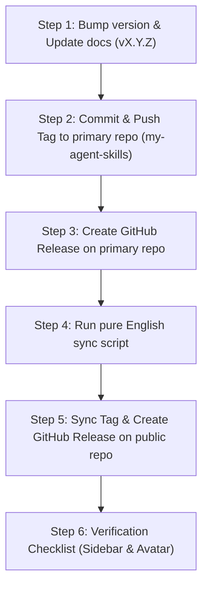

# 🚀 Professional Dual-Repository Release SOP

This document outlines the **Standard Operating Procedure (SOP)** for releasing new versions of the Kio System across its dual-repository architecture:
1. **Primary Core Repository**: `toanpham2111/my-agent-skills` (Source repo containing bilingual Vietnamese/English assets, internal tooling, benchmarks, and synchronization scripts).
2. **Public Distribution Repository**: `toanpham2111/kio-agent-system` (100% Pure English public release repository with zero Vietnamese characters, serving global developers).

---

## 🎯 5 Core Principles & Lessons Learned

Through the practical production releases of `v1.0.0` and `v1.0.1`, we codified 5 engineering requirements for zero-friction releases:

### 1. Differentiating Git Tags vs GitHub Release Objects
- **Issue**: Running `git tag v1.0.x && git push --tags` only creates a Git tag object on the remote. The GitHub homepage sidebar under **Releases** will only display `"2 tags / Create a new release"` and will **not** show the green `"v1.0.x Latest"` version card.
- **Solution**: Always create an official **GitHub Release Object** using the GitHub REST API or CLI:
  ```bash
  gh release create v1.0.x --repo toanpham2111/kio-agent-system --title "..." --notes "..."
  ```

### 2. Author Attribution & Avatar Linking
- **Issue**: Commits display a generic grey Octocat icon instead of the author's profile avatar.
- **Root Cause**: GitHub attributes commits to user profiles only when `git config user.email` matches an email registered and verified on the GitHub account (`toan444666@gmail.com`).
- **Solution**: Always ensure both local Git config and [scripts/sync_to_english_repo.sh](file:///home/toan/Toan/my-agent-skills/scripts/sync_to_english_repo.sh#L134-L135) use the verified email address:
  ```bash
  git config user.name "Toan Pham"
  git config user.email "toan444666@gmail.com"
  ```

### 3. Strict 100% Pure English Distribution
- The public distribution repository must be 100% pure English with zero Vietnamese characters.
- [scripts/sync_to_english_repo.sh](file:///home/toan/Toan/my-agent-skills/scripts/sync_to_english_repo.sh) automatically:
  - Swaps all `*.en.md` files to `*.md`.
  - Promotes `README.en.md` to the primary `README.md`.
  - Purges internal benchmarks, local sync tools, and binary PDFs.
  - Runs an automated regex byte scan across all files to guarantee 0 Vietnamese characters before pushing.

### 4. Tag Synchronization on Forced Snapshot Updates
- Because the public repository receives clean snapshots via `git push --force`, Git tags on the public repository must be patched or created (`git api -X PATCH`) to point directly to the new `HEAD` commit of `main`.

### 5. Absolute Credential Safety
- Personal Access Tokens (PAT) must only reside in the GitHub CLI secure configuration file (`~/.config/gh/hosts.yml` with `chmod 600` permissions).
- **Never** hardcode, echo, or commit authentication tokens to any Git tracked file.

---

## 📋 Manual Step-by-Step SOP



### Step 1: Bump Version & Update Documentation
1. Update version number and changes in [CHANGELOG.md](file:///home/toan/Toan/my-agent-skills/CHANGELOG.md).
2. Update release badges in [README.md](file:///home/toan/Toan/my-agent-skills/README.md) and [README.en.md](file:///home/toan/Toan/my-agent-skills/README.en.md):
   ```markdown
   [](https://github.com/toanpham2111/kio-agent-system/releases)
   ```
3. Ensure a clean working tree (`git status`).

### Step 2: Commit & Push to Primary Repo
```bash
git add .
git commit -m "chore(release): bump version to v1.0.x"
git push origin main
git tag v1.0.x
git push origin v1.0.x
```

### Step 3: Publish GitHub Release on Primary Repo
```bash
gh release create v1.0.x \
  --repo toanpham2111/my-agent-skills \
  --title "v1.0.x — <Release Title>" \
  --notes "### Highlights
- Feature 1
- Feature 2"
```

### Step 4: Synchronize to Public English Repo
```bash
./scripts/sync_to_english_repo.sh
```

### Step 5: Sync Tag & Publish GitHub Release on Public Repo
```bash
# Retrieve latest commit SHA on kio-agent-system
LATEST_SHA=$(gh api repos/toanpham2111/kio-agent-system/commits?per_page=1 --jq '.[0].sha')

# Update or create tag v1.0.x on kio-agent-system
gh api -X PATCH repos/toanpham2111/kio-agent-system/git/refs/tags/v1.0.x -f sha="$LATEST_SHA" -F force=true 2>/dev/null || \
gh api -X POST repos/toanpham2111/kio-agent-system/git/refs -f ref="refs/tags/v1.0.x" -f sha="$LATEST_SHA"

# Create official GitHub Release on kio-agent-system
gh release create v1.0.x \
  --repo toanpham2111/kio-agent-system \
  --title "v1.0.x — <English Release Title>" \
  --notes "### Highlights
- Feature 1
- Feature 2"
```

### Step 6: Verification Checklist
- [ ] Visit `https://github.com/toanpham2111/my-agent-skills/releases`: `v1.0.x Latest` badge visible.
- [ ] Visit `https://github.com/toanpham2111/kio-agent-system/releases`: `v1.0.x Latest` badge visible.
- [ ] Verify both latest commits display `@toanpham2111` avatar.
- [ ] Verify `./setup.sh` installs all 7 skills successfully.

---

## ⚡ 1-Command Automated Script: `scripts/release.sh`

For maximum developer velocity, use the automated release script:
[scripts/release.sh](file:///home/toan/Toan/my-agent-skills/scripts/release.sh).

```bash
# Usage:
./scripts/release.sh v1.0.2 "Release Title" "Highlights..."

# Or with a Markdown notes file:
./scripts/release.sh v1.0.2 "v1.0.2 — Feature Update" --notes-file release_notes.md
```
