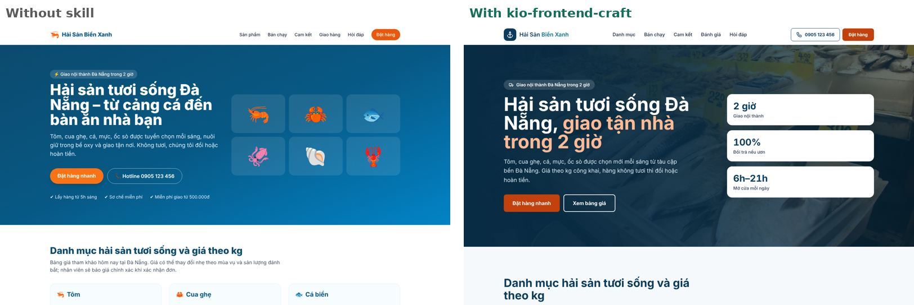
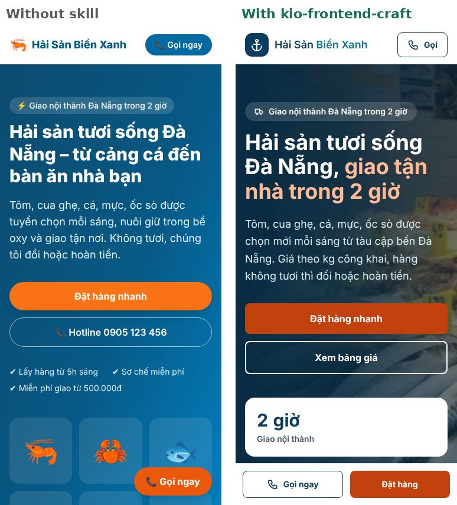
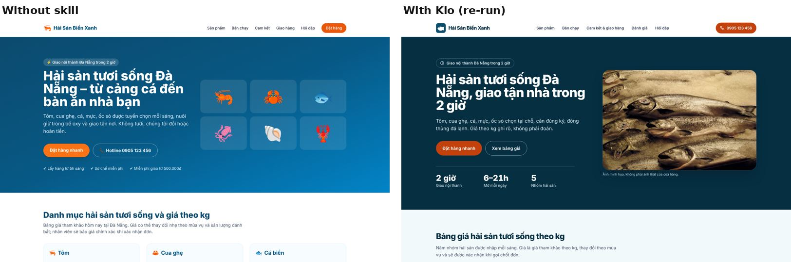
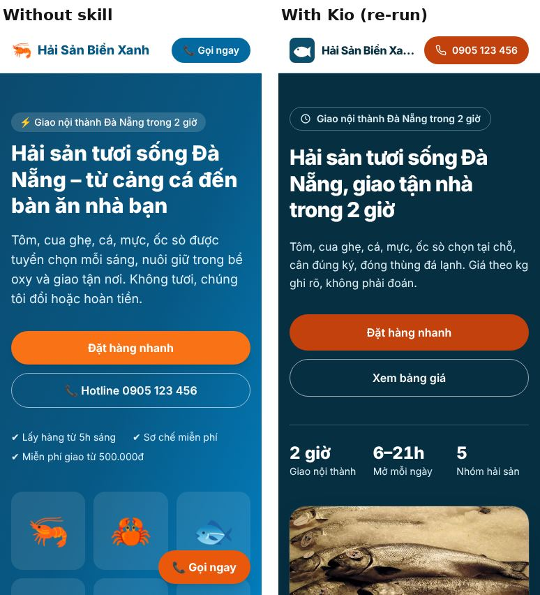

# 🦐 Real-world test: seafood shop website — without skill vs with `kio-frontend-craft`

2026-11-22 · Kio v1.3.0 · same prompt, same model **Claude Sonnet 5.5**, one run per condition in separate projects. Full data: [`results.json`](results.json).

**Prompt (Vietnamese):** a fresh-seafood shop site for "Hai San Bien Xanh" (Da Nang), SEO for the keyword "fresh seafood Da Nang": hero, categories with price per kg, bestsellers, freshness promise and delivery steps, reviews, FAQ, quick order form, footer; one `index.html`, Tailwind, responsive, Vietnamese content.

## Desktop (1440 px)

## Mobile (375 px)

Full pages: [without skill — desktop](images/baseline-desktop-full.jpg) · [mobile](images/baseline-mobile-full.jpg) · [with skill — desktop](images/with-skill-desktop-full.jpg) · [mobile](images/with-skill-mobile-full.jpg). Source: [`site-baseline/`](site-baseline/index.html) · [`site-with-skill/`](site-with-skill/index.html).

## Blind judge score (Claude Opus 5.5, not told which page used the skill)

| Criterion | Max | Without skill | With skill |
|---|:---:|:---:|:---:|
| Design & aesthetics | 20 | 13 | **17** |
| Layout & mobile | 15 | 12 | **13** |
| On-page SEO & structured data | 25 | 21 | **22** |
| Content & persuasion | 15 | 12 | **13** |
| Ordering experience | 15 | 10 | **12** |
| Accessibility | 10 | 7 | **9** |
| **Total** | **100** | **75** | **86** |

Judge's notes:
- **With skill:** a real seafood photo behind the hero, custom SVG icons, consistent CTA colour, correct price-per-kg JSON-LD (`UnitPriceSpecification`), and a form that validates input, moves focus to errors and actually sends the order. Lost points for no Zalo link, icon-only bestseller cards and a JSON-LD address without postal code/geo.
- **Without skill:** a well-linked `@graph` JSON-LD (with geo) and useful seasonal buying tips. Lost points for emoji used as icons and product images, and a form that shows "order received" while sending nothing (only a `TODO` in the code) — **orders are lost**; the floating "Call now" button covers hero content on mobile.

## Automated checks

| | Without skill | With skill |
|---|:---:|:---:|
| Lighthouse mobile — Performance / Accessibility / Best Practices / SEO | 100 / 96 / 100 / 100 | 98 / **100** / 96 / 100 |
| Lighthouse desktop — Performance / Accessibility / Best Practices / SEO | 100 / 96 / 100 / 100 | 100 / **100** / 96 / 100 |
| Contrast failures (Lighthouse) | main "Order" button 2.8:1 and 2 buttons at 3.55:1 | 0 |
| `layout-check.js` mobile — edge overflow | 1 (footer copyright line) | **0** |
| `layout-check.js` desktop — misaligned rows | 2 | 2 |
| SEO checks (title, meta, OG, canonical, one H1, no heading skips, keyword in title/H1/description) | pass | pass |
| Valid JSON-LD | 1 block | 2 blocks |
| HTML entities in source (`&amp;`…) | 1 | **0** |
| Images with `alt` | 0 images (emoji only) | 1/1 (credited stock photo) |

**Why did the with-skill page score slightly lower on Lighthouse?** The baseline loaded only 2 files (HTML 39 KB + CSS 18 KB): no photos, system fonts, emoji — nothing to slow it down. The with-skill page added a real hero photo (115 KB) and a **render-blocking** Google Fonts stylesheet (~810 ms, 5 font files), pushing mobile FCP/LCP to 1.8 s (Performance 98), and it had **no favicon**, so the browser logged a 404 (Best Practices 96).

**Confirming the cause with a hand fix** (not a new skill run): exactly 2 lines changed on the same with-skill page — non-blocking Google Fonts and a favicon, hero photo and everything else unchanged ([`manual-fix.diff`](manual-fix.diff), fixed page: [`site-with-skill-fixed/`](site-with-skill-fixed/index.html)) — then Lighthouse again: **100 / 100 / 100 / 100** on mobile and desktop (mobile FCP/LCP 1.1 s). Both points became mandatory skill rules in v1.3.0; the skill's own score will be measured in the next test.

Lighthouse ran on localhost with the same locally built Tailwind CSS replacing the CDN for every page.

## Time, tokens and cost

| | Without skill | With skill |
|---|:---:|:---:|
| Time | **1 min 55 s** | 8 min 2 s |
| Turns | 2 | 32 |
| Output tokens | **20,387** | 42,951 |
| Input tokens — total | **97,344** | 1,663,477 |
| ↳ cache reads (~10% price) | 68,520 | 1,594,742 |
| ↳ cache writes | 28,820 | 68,687 |
| Cost | **US$0.33** | US$0.86 |

The skill run looked up a design system, fetched 7 stock photos and kept the 1 that fit, and checked its JSON-LD and FAQ before delivering — hence roughly 2.6–4× the time and tokens.

## Re-run with the updated skill

Same day, same prompt, same **Claude Sonnet 5.5**, using `kio-frontend-craft` after the font and favicon rules were added. No hand edits. The baseline page is unchanged but was re-scored in the same judging pass as the new page. Source: [`site-with-skill-rerun/`](site-with-skill-rerun/index.html).

| Desktop 1440 px | Mobile 375 px |
|:---:|:---:|
|  |  |

Full pages: [desktop](images/rerun-with-skill-desktop-full.jpg) · [mobile](images/rerun-with-skill-mobile-full.jpg).

| | Without skill | With skill (re-run) |
|---|:---:|:---:|
| Blind judge (Opus 5.5) — total | 78 | **86** |
| ↳ Design / Layout / SEO / Content / Ordering / A11y | 13 / 12 / 22 / 13 / 11 / 7 | **16** / 12 / 22 / 13 / **14** / **9** |
| Lighthouse mobile — Perf / A11y / BP / SEO | 100 / 96 / 100 / 100 | 92 / **100** / **100** / 100 |
| Lighthouse desktop | 100 / 96 / 100 / 100 | **100 / 100 / 100 / 100** |
| Non-blocking Google Fonts / favicon | — | **yes / yes** (done by the skill) |
| `layout-check.js` desktop misaligned / mobile overflow | 2 / 1 | **0 / 0** |
| HTML entities in source | 1 | **0** |
| JSON-LD | 1 block | 1 `@graph` block (Store, per-kg OfferCatalog, FAQPage) |
| Images with `alt` | 0 images | 5/5 (credited stock photos) |
| Time | 1 min 55 s | 5 min 35 s |
| Output / input tokens | 20,387 / 97,344 | 49,022 / 2,306,718 (96% cache reads) |
| Cost | US$0.33 | US$1.05 |

Judge: the skill page wins on design, the order form (live running total, per-field errors, focus moved to the invalid field) and accessibility; SEO is even. The baseline scored 78 this time (75 the first time): the same page re-judged can move by a few points.

**Why only 92 for mobile Performance?** This time the skill used 5 real photos. The hero only had 640 and 1024 px files; a 380 px slot on a 1.75× phone screen needs about 665 px, so the browser downloaded the 1024 px file (184 KB) and mobile LCP reached 3.2 s. Confirmed: adding a 768 px file at quality 60 (60 KB) gives the same page Performance **99** (LCP 2.3 s). As of v1.3.2, `stock_images.py` writes 480 / 768 / 1024 / 1600 px steps and compresses the hero harder, and the skill has a "mobile LCP image ≤ ~80 KB" rule.

Remaining flaw to know about: on mobile the store name in the top bar is truncated with an ellipsis because the hotline button takes the space.

## Reading these results honestly
- One run without the skill, two with it (the first run and the re-run); every run can differ.
- The judge score is one AI model's assessment against the rubric above, not an absolute measurement.
- The skill is not perfect: in the first run the with-skill page still has 2 misaligned rows on desktop and a fixed mobile bar that covers some content — rule 10 and `layout-check.js` exist, but this run could not launch a browser to check itself. The re-run has no misaligned rows, but mobile Performance is only 92 and the store name is cut off on mobile.
