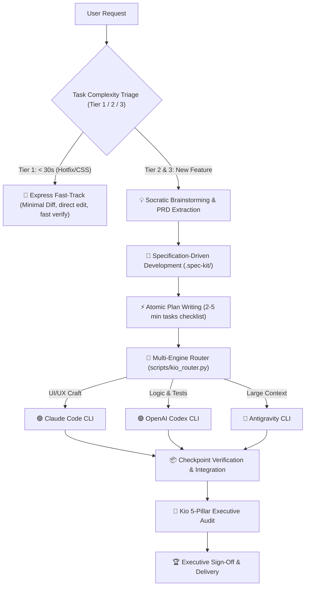

# 👑 Kio Master Core Delivery & Architecture Powerhouse (`kio-core-delivery`)

The unified executive leadership and lifecycle governance powerhouse of the Kio System. Integrates 9 core delivery and orchestration engines:

---

## 🧭 Core 9 Governance Engines Matrix

| Engine | Functional Module | Core Mission & Deliverables |
| :--- | :--- | :--- |
| **1. Executive CTO Governance** | `kio` | Enforces the 5-Pillar Audit (Security, Lean Code <700 lines, Anti-Slop UI/UX, SDD, Business Alignment). Final Executive Sign-Off. |
| **2. Multi-Engine Router** | `kio-engine-router` | Dynamically classifies tasks and routes to the optimal AI CLI (`claude` for UI/UX, `codex` for Algorithms/DB/Tests, `agy` for 1M+ Context & Monorepos). Script: `scripts/kio_router.py`. |
| **3. Socratic Brainstorming** | `kio-brainstorming` | Discovers root user intent via high-leverage Socratic inquiry, extracts PRDs, uncovers edge cases, and optimizes conversion (CRO). |
| **4. Specification-Driven Dev (SDD)** | `kio-spec-kit` | Enterprise architecture via 4 core artifacts: `constitution.md` (boundaries), `spec.md` (Gherkin user stories), `plan.md` (architecture & data models), `tasks.md` (atomic checklist). |
| **5. Atomic Plan Writing** | `kio-writing-plans` | Decomposes complex epics into independent 2–5 minute Atomic Tasks with verifiable checkpoint commands. |
| **6. Disciplined Plan Execution** | `kio-executing-plans` | Enforces disciplined execution adhering to TDD (Red-Green-Refactor) and mandatory two-stage review (Spec compliance & Code quality). |
| **7. Persistent File Planning** | `kio-planning-with-files` | Preserves cross-session state and architectural memory in `kio-memory/` (`task_plan.md`, `progress.md`, `findings.md`). |
| **8. Parallel Agent Dispatcher** | `kio-dispatching-parallel-agents` | Coordinates concurrent sub-agents across isolated workstreams with zero context collision. |
| **9. Isolated Workspace Management** | `kio-git-worktrees` | Manages isolated Git worktrees and feature branches to execute parallel initiatives cleanly without merge conflicts. |

---

## 🚀 1. End-to-End Delivery SOP



---

## 🛠️ 2. Integrated Utility Arsenal

### A. CLI Multi-Engine Router:
```bash
# View engine availability matrix
kio-router matrix

# Classify intent and get routing recommendation
kio-router classify "Design a responsive landing page hero with smooth Lenis scroll"

# Dispatch task with dry-run preview
kio-router dispatch "Write comprehensive unit tests for Stripe webhook idempotency" --dry-run
```

### B. Visual Brainstorming Companion Server:
```bash
# Start visual brainstorming companion server (ports 3333-3343)
bash skills/kio-core-delivery/scripts/start-server.sh

# Stop server after brainstorming completes
bash skills/kio-core-delivery/scripts/stop-server.sh
```
